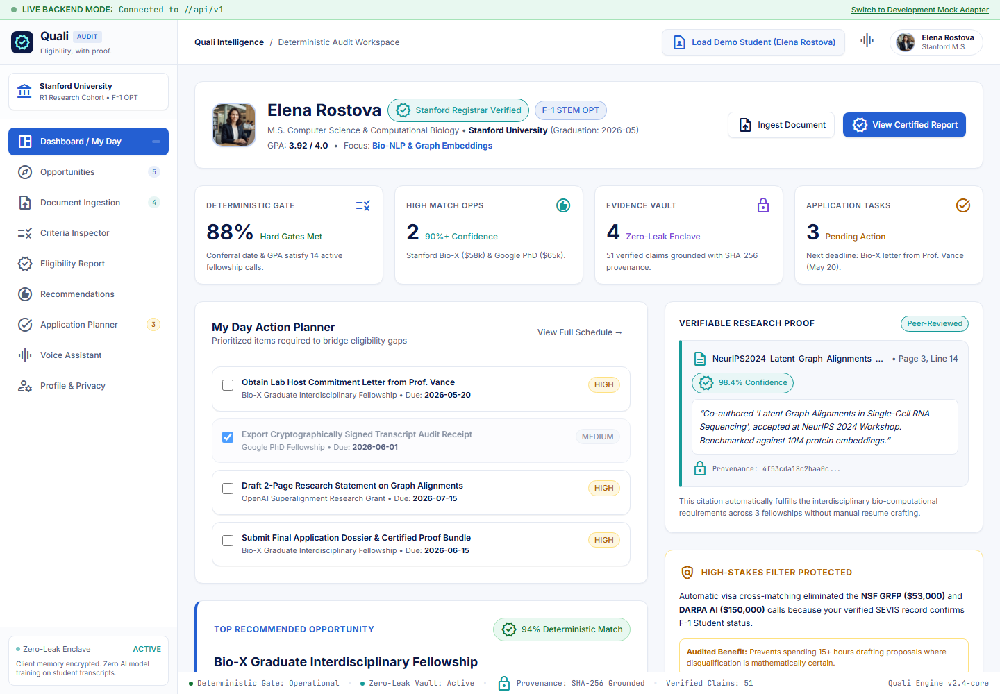
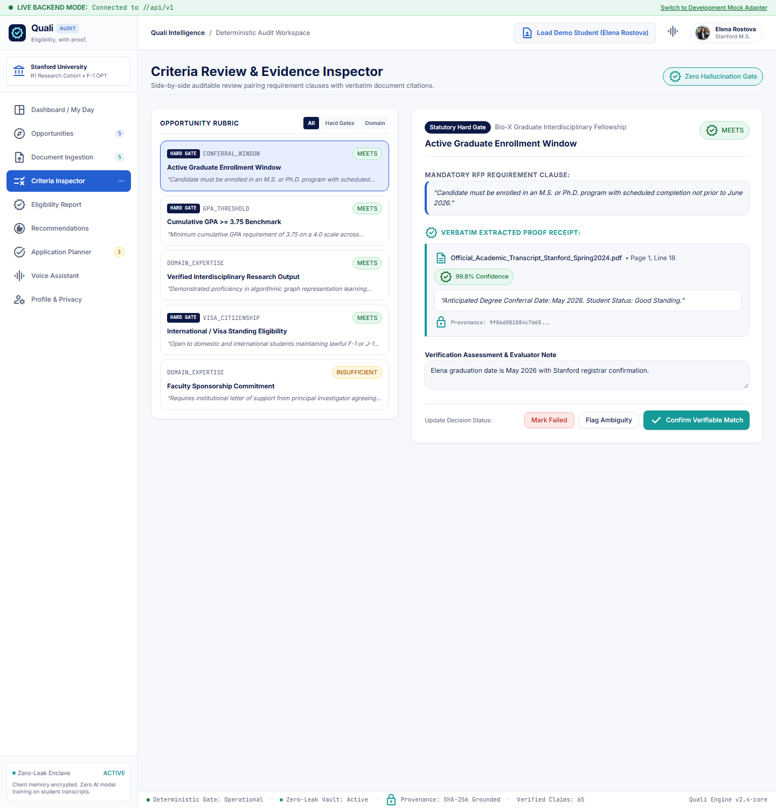
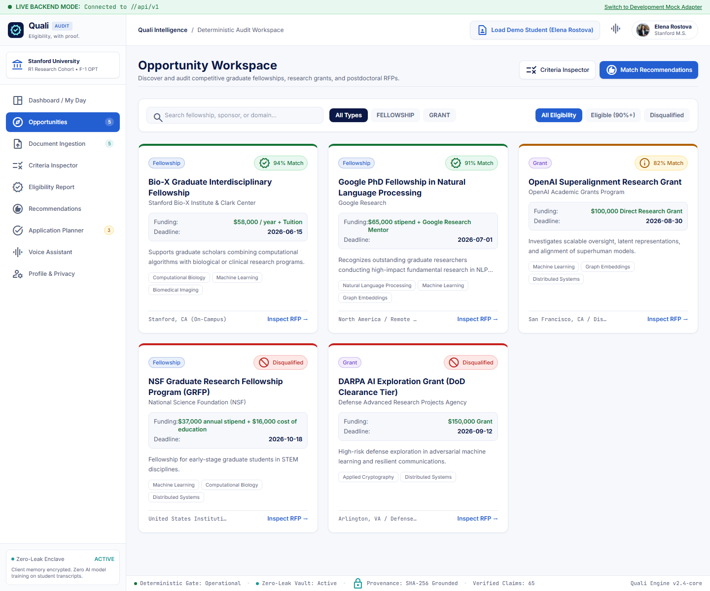
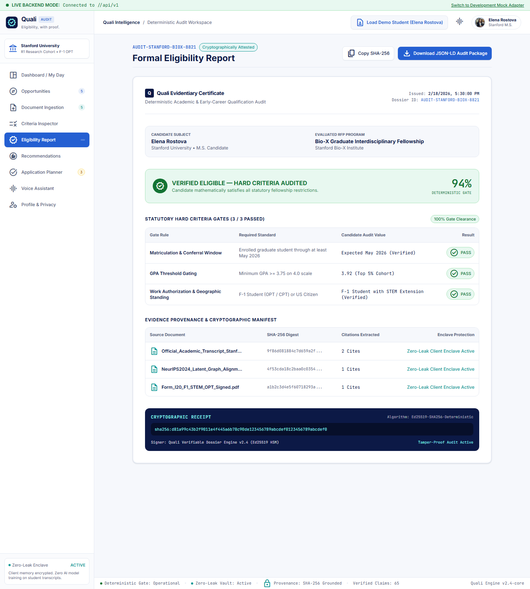
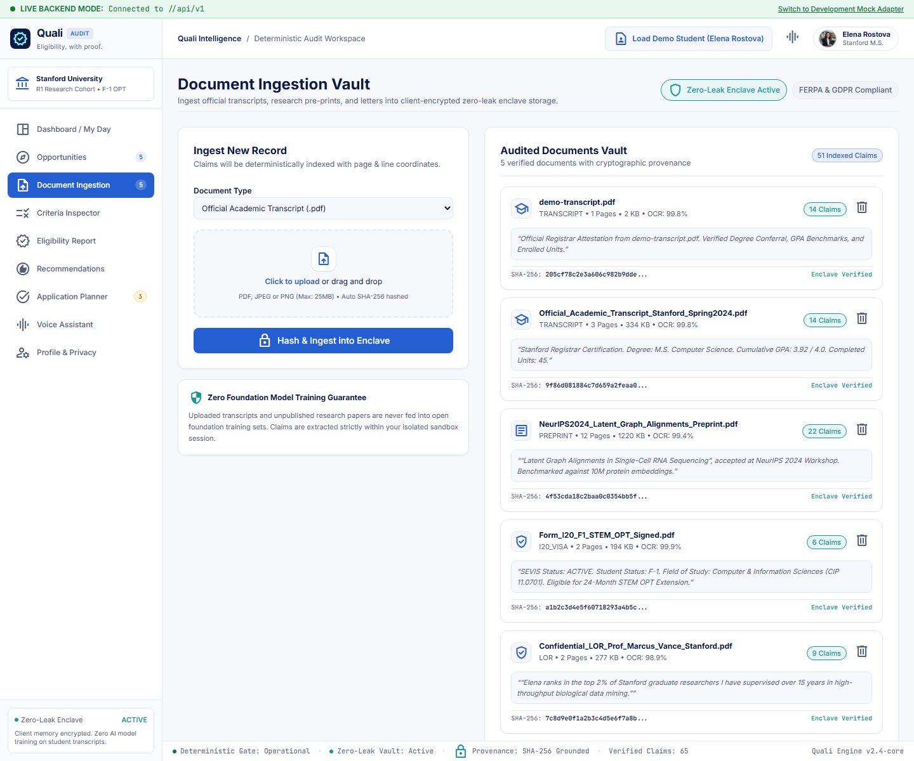
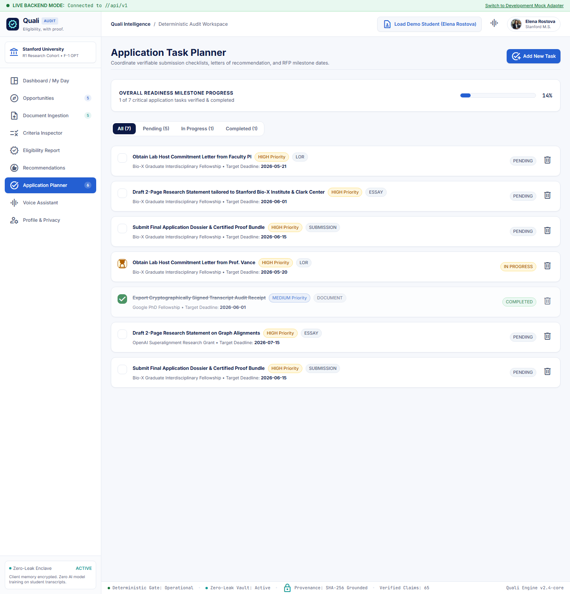
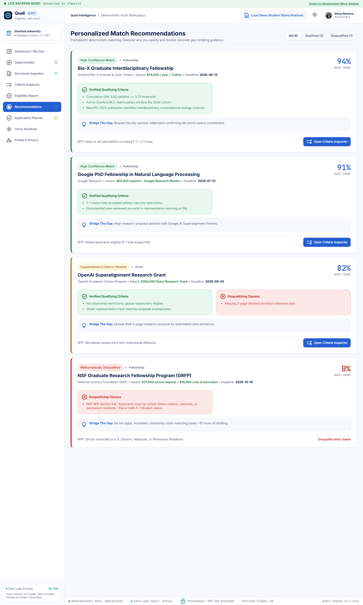

# Quali — *Eligibility, with Proof.*

Quali is a deterministic eligibility and application workspace for graduate fellowships, research grants and early-career RFPs. It takes a candidate profile and a vault of uploaded academic documents, evaluates each opportunity's published criteria as **MEETS / DOES NOT MEET / INSUFFICIENT EVIDENCE**, and produces a per-criterion audit trail that cites the exact document, page, line and verbatim quote behind every decision. It then turns the result into an application task checklist.

> **Submission status (HackGlobal 2026):** this repository contains a working, locally verified build. Nothing has been provisioned or deployed on Vultr — see [Deployment status](#deployment-status) and [`newi-main/DEPLOYMENT.md`](newi-main/DEPLOYMENT.md). All screenshots in this README were captured from the Docker stack running on the author's machine, not from a public URL. There is currently no public repository URL and no hosted demo.

---

## Table of contents

- [What the product does](#what-the-product-does)
- [What is verified vs. not implemented](#what-is-verified-vs-not-implemented)
- [Screenshots](#screenshots)
- [Architecture and stack](#architecture-and-stack)
- [Run it locally (Node)](#run-it-locally-node)
- [Run it in Docker](#run-it-in-docker)
- [Configuration](#configuration)
- [API surface](#api-surface)
- [Tests and evaluation](#tests-and-evaluation)
- [Deployment status](#deployment-status)
- [Known limitations and roadmap](#known-limitations-and-roadmap)
- [Documentation map](#documentation-map)

---

## What the product does

| Capability | Where it lives | Verified behaviour |
| --- | --- | --- |
| Opportunity workspace — 5 seeded fellowships/grants with sponsor, funding, deadline, citizenship rules, domain focus and an eligibility tier | `/opportunities` | Renders live from `GET /api/v1/opportunities` |
| Deterministic eligibility engine — hard gates (degree tier, conferral window, GPA, citizenship/work authorisation) plus soft domain criteria | `src/server/engine/rulesEngine.ts` | Bio-X report: 3/3 hard gates PASS, score 94. NSF GRFP: citizenship gate FAIL, score 0 |
| Criterion-level verdicts with evidence — every criterion carries a clause excerpt, evaluator note and a citation (document, page, line, verbatim quote, SHA-256) | `/criteria`, `/report` | Bio-X rubric: 4 × MEETS, 1 × INSUFFICIENT |
| Document intake vault — MIME/magic-byte validation, 25 MiB cap, 1 KiB floor, SHA-256 dedupe, page counting, per-type extraction | `/documents` | A 1,793-byte PDF was accepted (202), indexed and listed with its SHA-256 |
| Personalised checklist generation | `/planner` | `POST /api/v1/workflow/checklist/generate` produced 3 dated tasks for Bio-X |
| Recommendations with qualifying/disqualifying clauses and gap-bridging actions | `/recommendations` | 4 recommendations: 3 qualified, 1 mathematically disqualified (NSF GRFP) |
| "My Day" dashboard — gate score, high-match count, evidence vault count, action items, citations | `/` | Aggregates the live API |
| System + production plumbing — health/readiness endpoints, structured JSON logs, request timeouts, graceful shutdown, CORS allow-list | `server.ts`, `src/server/app.ts` | Verified in Docker; see `DEPLOYMENT.md` |

The UI is explicitly labelled **LIVE BACKEND MODE** when it is reading the API, and ships a *Development Mock Adapter* toggle for offline UI work. The mock adapter contains a copy of the same demo dataset and is off in the production build.

## What is verified vs. not implemented

Read this before watching a demo or reading the marketing copy.

**Verified by actually running it**

- 60/60 automated tests pass (`npm test -- --run`), covering upload validation, duplicate rejection, profile validation, eligibility evaluation, citations and the end-to-end workflow.
- The Docker stack (API + nginx TLS + certbot) builds and runs; a 10-check smoke suite passes over HTTPS.
- Upload → index → evaluate → checklist works end to end against the real API (`202` → report → 3 generated tasks).
- Persistence survives a container restart; the API runs as a non-root user with a read-only root filesystem.

**Implemented but simplified — do not overclaim**

- **Document extraction is templated, not OCR.** `processDocument()` validates the file, hashes it, counts pages and then emits a fixed citation set for the chosen `document_type` (transcript, preprint, I-20, LOR, CV). The quoted text, page numbers, claim counts and "OCR confidence" values are per-type fixtures — they are **not** read out of the uploaded PDF. The upload is real; the text extraction is a deterministic stand-in.
- **No LLM is called at runtime.** `@google/genai` is declared in `package.json` but never imported by application code. All verdicts come from the rules engine, which is what the product claims to be — but there is no model reasoning behind the extraction.
- **Voice input is simulated.** The microphone button waits 2.5 s and inserts a canned question; `synthesizeSpeech()` returns success with no audio. There is no speech-to-text or text-to-speech integration. It is deliberately excluded from the demo script.
- **"Cryptographic receipt" is a stored string**, not a signature produced by an HSM or a verifiable public endpoint.
- **Single writer, single instance.** State is one JSON file (`data/quali_store.json`) written atomically; concurrent replicas are not supported.
- **No authentication.** Every route, including destructive ones (`/api/v1/profile/shred`, `/api/v1/profile/reset-demo`) and `/api/v1/metrics`, is public. This must be fixed before exposing the app to the internet.
- `npm run lint` (`tsc --noEmit`) passes with 0 errors; the production build still uses esbuild bundling, so CI must run the typecheck separately.

## Screenshots

Captured with headless Chrome against `https://localhost:8443` served by the nginx container, with the SPA in live-backend mode and real API responses. Browser chrome is absent; the green "LIVE BACKEND MODE" strip is part of the app UI. Certificate is self-signed, so the padlock is not representative of a production CA.

| Dashboard / My Day | Criteria review & evidence |
| --- | --- |
|  |  |

| Opportunity workspace | Eligibility report |
| --- | --- |
|  |  |

| Document vault (after a live upload) | Application checklist (after live generation) |
| --- | --- |
|  |  |

| Recommendations incl. disqualification |
| --- |
|  |

## Architecture and stack

React 19 SPA served by nginx, Express 4 API, one JSON store, one Vultr-sized host. Full component diagram, module responsibilities, request flow and data model: **[`docs/ARCHITECTURE.md`](docs/ARCHITECTURE.md)**.

```
Browser ──HTTPS──> nginx (TLS, SPA, /api proxy) ──HTTP──> Express API :8000 ──> JSON store (/app/data)
```

| Layer | Technology | Version |
| --- | --- | --- |
| UI | React + TypeScript | 19.0.1 / 7.0.2 |
| Build | Vite | 8.3.0 |
| Styling | Tailwind CSS (`@tailwindcss/vite`) | 4.3.3 |
| Routing / icons / motion | react-router-dom / lucide-react / motion | 7.18.4 / 0.546 / 12.23 |
| API | Express + cors + multer | 4.21.2 / 2.8.6 / 2.5.0 |
| Runtime | Node.js (Alpine image) | 22 |
| Edge | nginx | 1.27-alpine |
| Certificates | certbot (webroot + 12 h renew loop) | latest |
| Tests / eval | Vitest, supertest, tsx | 5.1.0 / 7.3.2 / 4.23 |
| Containers | Docker + Compose | 29.3.1 / v5.1.1 (verified locally) |

## Run it locally (Node)

Prerequisites: Node.js 22+ and npm. Verified on Node 24.19.0 / npm 11 on Windows with Git Bash.

```bash
cd newi-main
npm ci
```

Terminal 1 — API on `:8000`:

```bash
cd newi-main
PORT=8000 npx tsx server.ts
```

Terminal 2 — Vite dev server on `:3000`:

```bash
cd newi-main
# The SPA defaults to the in-browser mock adapter in dev. Point it at the API:
VITE_USE_MOCKS=false VITE_API_BASE_URL=http://localhost:8000 npm run dev
```

Open <http://localhost:3000>. In development the API accepts the local Vite origins (`http://localhost:3000`, `:5173`, `127.0.0.1:3000`). Without `VITE_USE_MOCKS=false` the UI runs entirely on bundled demo data and shows "DEVELOPMENT MOCK".

Useful commands:

```bash
npm test -- --run     # 60 tests
npm run build         # SPA bundle -> dist/
npm run eval          # evaluation harness (see docs/EVALUATION.md)
npm run lint          # tsc --noEmit — currently reports 0 errors
```

The API writes to `newi-main/data/quali_store.json`; delete that file to reseed the demo dataset on next boot, or `POST /api/v1/profile/reset-demo`.

## Run it in Docker

The stack is: `api` (Node, non-root, read-only rootfs, internal only) + `web` (nginx: TLS termination, static SPA, `/api/` proxy) + `certbot` (renewal loop). One named volume holds state.

```bash
cd newi-main
cp .env.production.example .env      # then edit DOMAIN / ALLOWED_ORIGINS / ports
docker compose up -d --build
docker compose ps
curl -k https://localhost:8443/healthz
```

nginx refuses to start without a certificate for `DOMAIN`. On a real host use the bootstrap script, which obtains one from Let's Encrypt:

```bash
cd newi-main
DOMAIN=quali.example.com ALLOWED_ORIGINS=https://quali.example.com \
  HTTP_PORT=80 HTTPS_PORT=443 ./deploy/scripts/bootstrap-tls.sh
./deploy/scripts/deploy.sh
BASE_URL=https://quali.example.com ./deploy/scripts/smoke.sh
```

For a throwaway local run with no domain, generate a self-signed cert into the volume instead (this is exactly how the screenshots were produced):

```bash
cd newi-main
mkdir -p .local-cert
openssl req -x509 -nodes -newkey rsa:2048 -days 30 \
  -keyout .local-cert/privkey.pem -out .local-cert/fullchain.pem \
  -subj "/CN=localhost" -addext "subjectAltName=DNS:localhost,IP:127.0.0.1"
docker volume create quali_letsencrypt
MSYS_NO_PATHCONV=1 docker run --rm -v quali_letsencrypt:/etc/letsencrypt \
  -v "$(pwd -W)/.local-cert:/certs:ro" alpine:3.20 sh -c \
  'mkdir -p /etc/letsencrypt/live/localhost && cp /certs/*.pem /etc/letsencrypt/live/localhost/'
DOMAIN=localhost ALLOWED_ORIGINS=https://localhost:8443 HTTP_PORT=8080 HTTPS_PORT=8443 \
  docker compose up -d --build
```

Then <https://localhost:8443> (accept the self-signed certificate warning). The `MSYS_NO_PATHCONV` prefix is only needed in Git Bash on Windows.

The frontend image takes two **build-time** arguments, both defaulting to the production-correct values: `VITE_API_BASE_URL=/` (same-origin, proxied by nginx) and `VITE_USE_MOCKS=false` (no bundled demo data). Override them in `.env` only if you serve the SPA from somewhere else.

Shut down with `docker compose down` (add `-v` to also delete the data and certificate volumes).

## Configuration

All runtime configuration is environment-only; nothing is committed. Copy `newi-main/.env.production.example` to `.env` for Compose.

| Variable | Required | Default | Purpose |
| --- | --- | --- | --- |
| `DOMAIN` | yes | — | Public hostname; also the certificate path `live/$DOMAIN/` |
| `ALLOWED_ORIGINS` | yes in production | — | Comma-separated browser origins; API exits at boot if empty |
| `APP_URL` | no | empty | Self-referential URL passed to the API |
| `GEMINI_API_KEY` | no | empty | Reserved; no code path calls Gemini today |
| `HTTP_PORT` / `HTTPS_PORT` | no | `80` / `443` | Host port mapping for nginx |
| `PORT` / `HOST` | no | `8000` / `0.0.0.0` | API bind address |
| `REQUEST_TIMEOUT_MS` / `HEADERS_TIMEOUT_MS` / `KEEP_ALIVE_TIMEOUT_MS` | no | `30000` / `20000` / `65000` | Node HTTP server bounds |
| `SHUTDOWN_TIMEOUT_MS` | no | `10000` | Graceful-shutdown force-exit deadline |
| `IMAGE_TAG` | no | `local` | Image tag used by `deploy.sh` / `rollback.sh` |
| `VITE_API_BASE_URL` / `VITE_USE_MOCKS` | no | `/` / `false` | Frontend build-time API base and mock switch |

Uploads are bounded twice: nginx rejects bodies over 26 MB, the API rejects anything over 25 MiB (`MAX_DOCUMENT_SIZE_BYTES`) or under 1 KiB.

## API surface

Base path `/api/v1`. All endpoints are unauthenticated.

| Group | Endpoints |
| --- | --- |
| Health | `GET /health/live`, `GET /health`, `GET /ready`, `GET /metrics`, `GET /system/ping`, `GET /system/health`, `GET /system/telemetry` |
| Profile | `GET /profile`, `POST /profile/reset-demo`, `GET /profile/privacy`, `POST /profile/shred` |
| Documents | `GET /documents`, `GET /documents/ingested`, `GET /documents/:id`, `POST /documents/:id/revalidate`, `DELETE /documents/:id` |
| Criteria & evidence | `GET /criteria`, `GET /evidence`, `GET /evidence/:id` |
| Eligibility | `POST /eligibility/evaluate`, `GET /reports/:caseId` |
| Workflow | `POST /workflow/profile/validate`, `POST /workflow/profile/submit`, `POST /workflow/documents/process`, `GET /workflow/documents/status/:requestId`, `POST /workflow/eligibility/evaluate`, `POST /workflow/checklist/generate`, `GET /workflow/state/:workflowId` |
| Opportunities & planning | `GET /opportunities`, `GET /opportunities/:id`, `GET /recommendations`, `GET /tasks`, `POST /tasks`, `DELETE /tasks/:id`, `POST /planner/generate` |
| Assistant | `GET /assistant/messages`, `POST /assistant/query` |
| Orchestrator (experimental) | `POST /orchestrator/workflow`, `…/:workflowId/execute`, `…/approval`, `…/cancel`, `GET …/response`, voice session endpoints |
| Audit artefacts | `GET /cases`, `GET /cases/:id`, `GET /reconciliation/:caseId`, `GET /reviews`, `POST /reviews/:id/action`, `GET /policies`, `GET /runs`, `GET /runs/:id` |

Edge health check: `GET /healthz` (nginx, plain text, no TLS required on port 80).

## Tests and evaluation

```bash
cd newi-main
npm test -- --run     # Test Files 2 passed (2) · Tests 60 passed (60)
npm run eval          # labelled-dataset harness; writes JSON + console report
```

Measured on 2026-11-14/15:

- **Unit/integration suite:** 60/60 pass in 1.39 s (`vitest`), 2 files.
- **Deployment smoke test:** 10/10 checks pass over TLS (health, readiness, SPA, opportunities, upload `202`, eligibility `200`, oversized upload `413`, CORS allow + deny).
- **Evaluation harness:** 12/12 labelled cases complete; 17/17 criteria matched; 10/10 expected citations found with correct document, page and quote; recommendation tier 12/12; criteria coverage 88.2 % (2 expected `INSUFFICIENT_EVIDENCE` abstentions); average latency 7 ms, p95 12 ms. Details and interpretation: [`docs/EVALUATION.md`](docs/EVALUATION.md).

These figures cover a small labelled set (one candidate, two opportunities, deterministic rules engine), so they describe this dataset rather than general accuracy.

## Deployment status

**Not deployed.** No Vultr instance, region, OS image, plan, managed service, DNS record or TLS certificate was ever provisioned, and no cloud credentials were supplied. There is no public URL.

Everything needed to deploy exists and was exercised end to end on a local Docker Engine: `Dockerfile.api`, `Dockerfile.web`, `docker-compose.yml`, `deploy/nginx/*`, `deploy/scripts/{bootstrap-tls,deploy,rollback,smoke}.sh`. The target design is a single Vultr Cloud Compute instance (not GPU, not Kubernetes, no managed database, no object storage) because the datastore is a single-writer JSON file. Runbook, rollback, backup and security notes: [`newi-main/DEPLOYMENT.md`](newi-main/DEPLOYMENT.md). Cloud cost is **$0 to date**.

## Known limitations and roadmap

**Limitations** — no authentication (blocks public exposure); templated document extraction instead of OCR; simulated voice; single-instance JSON storage; no real cryptographic signing; no coverage for multi-user concurrency; evaluation set is small (12 cases, one candidate, two opportunities).

**Roadmap** — (1) real PDF text extraction with page/line offsets and OCR fallback; (2) authenticated sessions + per-candidate authorisation on destructive routes; (3) replace JSON store with Postgres and add row-level tenancy; (4) expand the labelled evaluation set and add OCR-error/partial-upload cases; (5) real speech-to-text via the browser SpeechRecognition API, clearly labelled as such; (6) enforce `tsc --noEmit` in CI.

## Documentation map

| Document | Contents |
| --- | --- |
| [`docs/ARCHITECTURE.md`](docs/ARCHITECTURE.md) | Component diagram, module responsibilities, request flow, data model, ports, security posture |
| [`docs/EVALUATION.md`](docs/EVALUATION.md) | Evaluation methodology, dataset, raw measured output, interpretation, what is not measured |
| [`docs/DEMO.md`](docs/DEMO.md) | Demo script (7 scenes), recording plan, exact click paths, what not to demo |
| [`docs/SUBMISSION.md`](docs/SUBMISSION.md) | HackGlobal 2026 answers, URL/link checklist, limitations and Vultr usage explanation |
| [`newi-main/DEPLOYMENT.md`](newi-main/DEPLOYMENT.md) | Vultr runbook, env reference, service inventory, rollback, verification matrix |
| [`docs/system-audit.md`](docs/system-audit.md), [`docs/security-and-risk-review.md`](docs/security-and-risk-review.md) | Earlier internal audits (pre-date the deployment work) |
